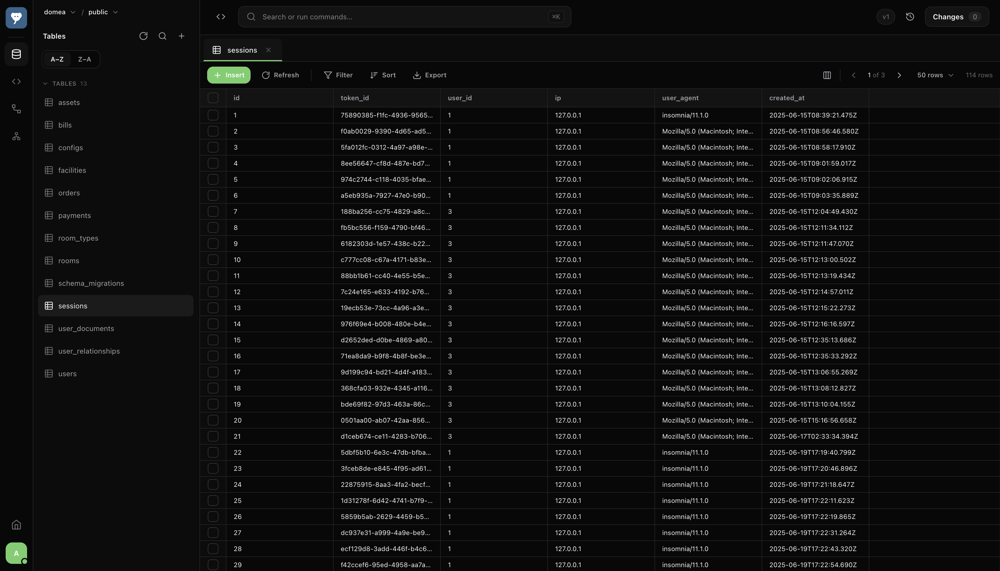
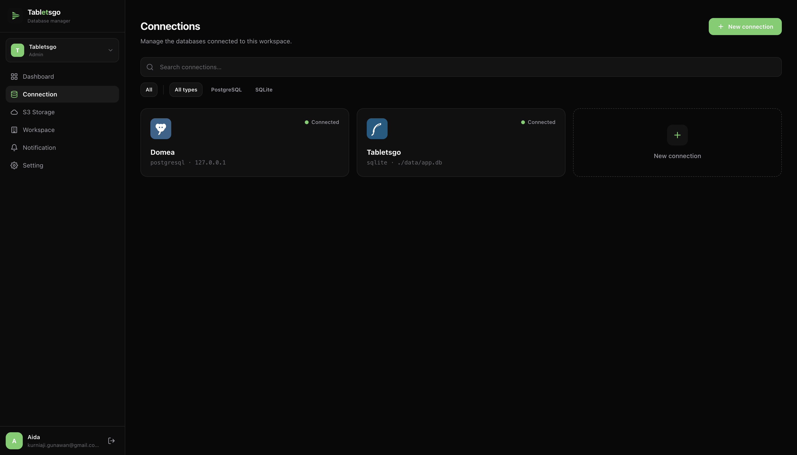
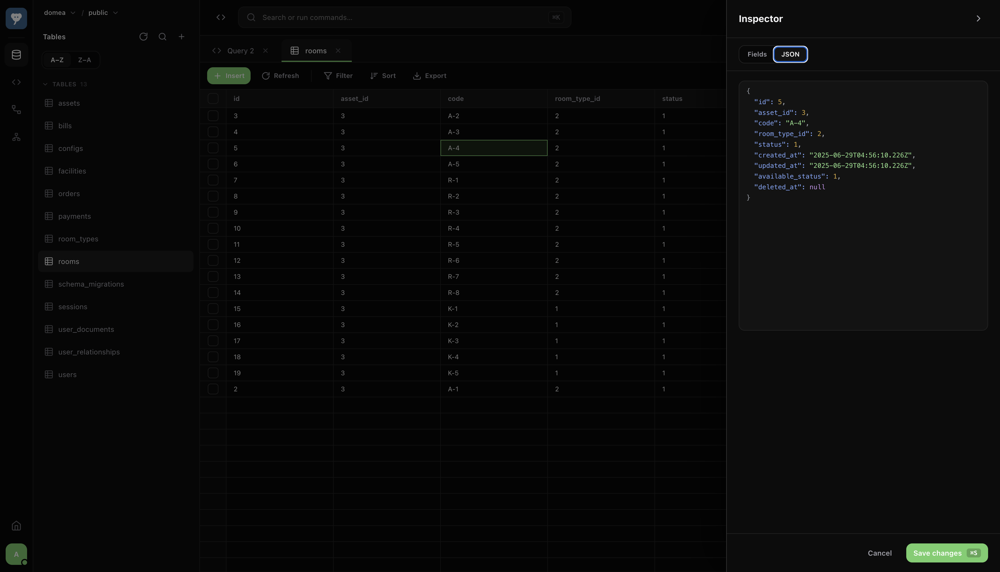
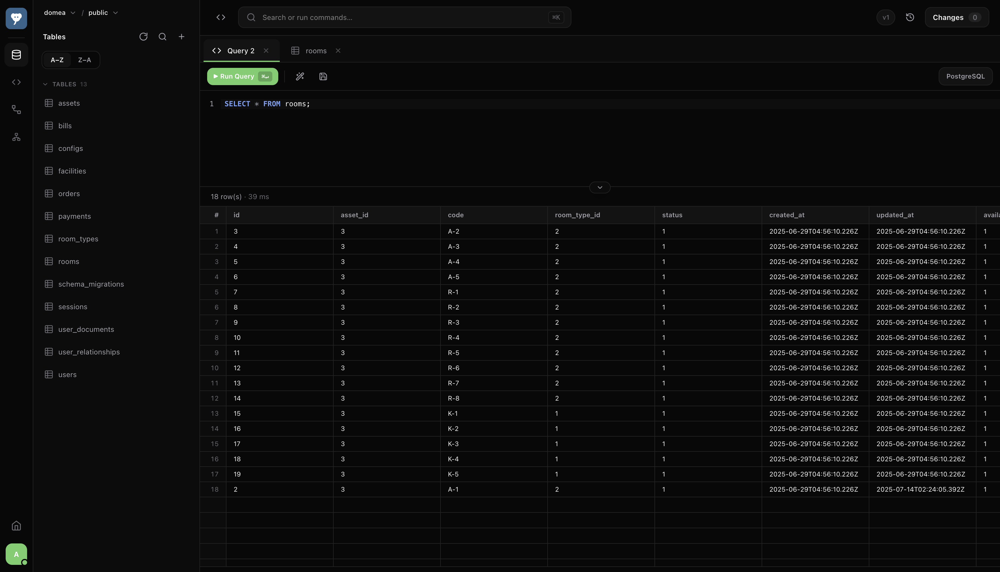
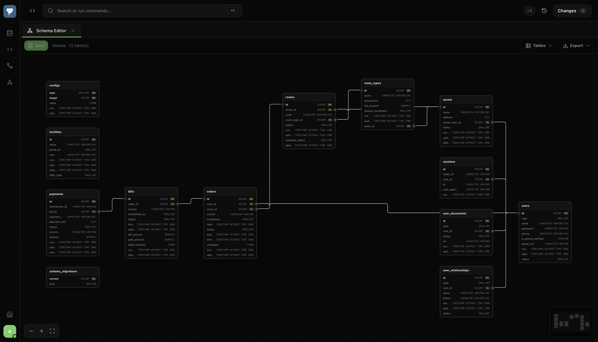
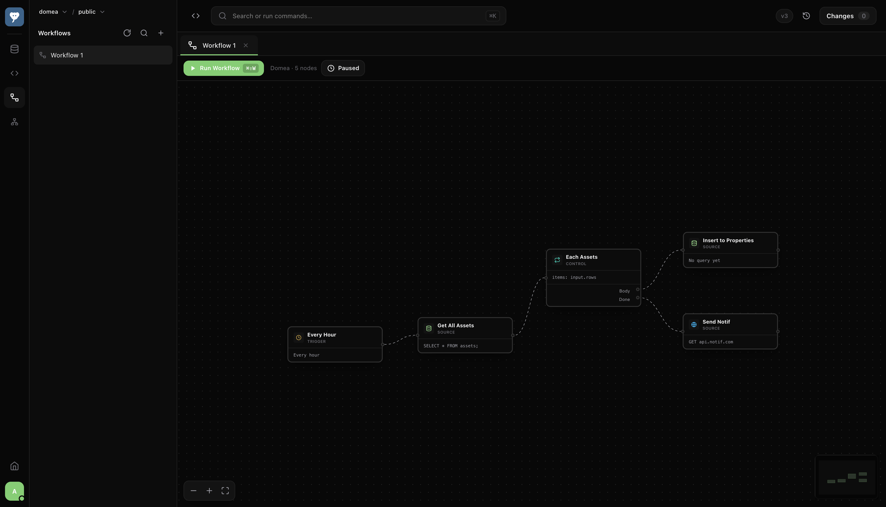
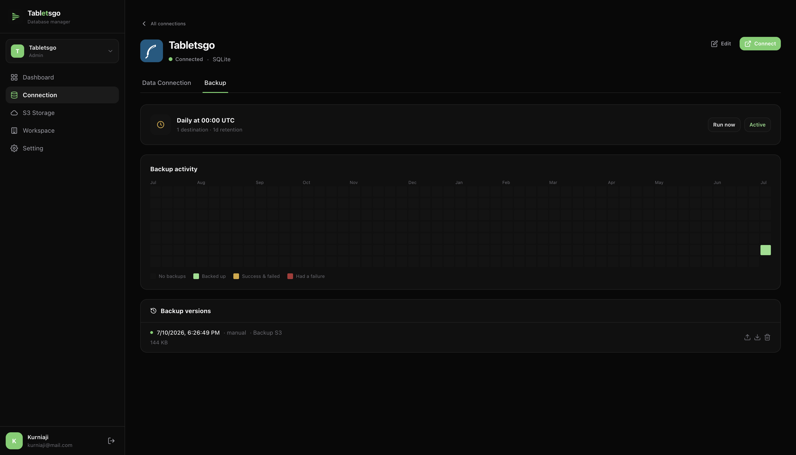

<div align="center">


# Tabletsgo

**A self‑hosted, team‑friendly database console.**
Browse data, write queries, design schemas, automate workflows and back up to S3 — from one web app you run yourself.

[](package.json)
[](#quick-start)
[](https://react.dev)
[](https://www.typescriptlang.org)

</div>

<p align="center">
  
</p>

**Databases:** PostgreSQL, MySQL, MariaDB, SQLite, Redis and Kafka. MongoDB is planned.

## Features

- **Data browser** — a spreadsheet‑style grid: filter, sort, edit inline, review changes before you commit.
- **SQL editor** — highlighting, formatting, history, saved queries and a command reference.
- **Redis and Kafka consoles** — key trees and commands; topics, messages, consumer groups, Schema Registry, Connect and ksqlDB.
- **Schema designer** — a visual ERD that releases DDL in one step and rolls back by version.
- **Dashboards and workflows** — query widgets with variables and thresholds; scheduled or webhook‑triggered automations.
- **Backups** — scheduled dumps to any S3‑compatible bucket, restored in one click.
- **SSH tunnels** — through a bastion, Railway or Cloudflare Access.
- **Secure by default** — credentials encrypted at rest (AES‑256‑GCM), every permission checked on the server.
- **Modules, themes, in‑app updates**, split view and a configurable keymap.

Every feature in detail: [docs/FEATURES.md](docs/FEATURES.md).

<table>
  <tr>
    <td width="33%"><p align="center"><sub>Connections</sub></p></td>
    <td width="33%"><p align="center"><sub>Data browser</sub></p></td>
    <td width="33%"><p align="center"><sub>SQL editor</sub></p></td>
  </tr>
  <tr>
    <td width="33%"><p align="center"><sub>Schema designer</sub></p></td>
    <td width="33%"><p align="center"><sub>Workflows</sub></p></td>
    <td width="33%"><p align="center"><sub>Backups</sub></p></td>
  </tr>
</table>

## Quick start

All you need is Docker:

```bash
docker run -d --name tabletsgo -p 3000:3000 -v tabletsgo-data:/app/data ghcr.io/aidapedia/tabletsgo
docker logs tabletsgo     # 🔑 Solo setup: … enter this code: amber-falcon-river-stone-maple-orbit
```

Open **http://localhost:3000**, enter the setup code, your name, email and a password. Then pick the databases you want under
**Administration → Modules**.

Back up the volume: it holds your data and the generated `encryption.key`. Forgot your password? Run
`docker exec tabletsgo npm run solo:reset-password`.

## Solo and enterprise

One image runs either way. Both are free.

| | Solo | Enterprise |
|---|---|---|
| For | one developer | a team |
| Runs | tabletsgo alone | tabletsgo + [Hayat](https://github.com/aidapedia/hayat) 1.2.0 or newer |
| Sign-in | the owner's email and password | single sign-on at Hayat |
| People and access | just the owner | workspaces, rosters and roles in Hayat's console |

A new instance starts in enterprise mode when `HAYAT_ISSUER` is set, otherwise in solo mode, and remembers it (`TABLETSGO_MODE` overrides). An instance that
has run in enterprise mode never falls back to solo.

### Enterprise mode

**Everything on one machine:** `docker-compose.hayat.yml` runs Hayat beside tabletsgo.

```bash
echo "ENCRYPTION_KEY=$(openssl rand -hex 32)" >> .env
echo "HAYAT_MASTER_KEY=$(openssl rand -base64 32)" >> .env
alias dc='docker compose -f docker-compose.yml -f docker-compose.hayat.yml'
dc up -d
dc logs hayat | grep setup     # open the link: create Hayat's first admin
dc exec hayat hayat enrollment-code --service tabletsgo --name Tabletsgo
```

Open **http://localhost:3000**, paste the code and sign in; manage people and roles in Hayat's console at
**http://localhost:3001**. Behind https, set `HAYAT_ISSUER` and `HAYAT_CONSOLE_URL` to their public addresses and `HAYAT_DEV=false`.

**Hayat already running elsewhere:**

1. Deploy Hayat ([its compose file](https://github.com/aidapedia/hayat/tree/main/deploy/compose)).
2. In `.env`, set `ENCRYPTION_KEY` (`openssl rand -hex 32`), `HAYAT_ISSUER` and `HAYAT_API_URL`.
3. Start it: `docker compose -f docker-compose.yml -f docker-compose.enterprise.yml up -d`.
4. Open tabletsgo and paste an enrollment code from Hayat's console (**Services → Enroll service**, namespace `tabletsgo`). Then sign in.

### Moving from solo to enterprise

Your data comes along: run `npm run hayat:bundle -- --out /app/data/hayat-import.json` in the container, load it
with `hayat import --file hayat-import.json --out hayat-result.json`, then follow the steps above and sign up at Hayat with the
owner's email. Keep the same `ENCRYPTION_KEY` (copy `/app/data/encryption.key` if solo generated it).

With the bundled Hayat, after `dc up -d` and creating Hayat's first admin, load the bundle straight from the tabletsgo container:

```bash
dc exec tabletsgo npm run hayat:bundle -- --out /app/data/hayat-import.json
dc exec -T tabletsgo cat /app/data/hayat-import.json | dc exec -T hayat hayat import --file /dev/stdin --app-url http://localhost:3000
```

A connection from before workspaces existed is filed under its owner's workspace on the way. If boot warns that some belong to
no workspace, file them with `npm run connections:assign -- --workspace <id>` in the container.

### Upgrading

`docker compose pull && docker compose up -d` — the store migrates on start. In enterprise mode, upgrade Hayat first.

## Requirements

1 vCPU, 1 GB RAM and Docker is enough for a team; tabletsgo itself uses about 150–250 MB. Details: [docs/BENCHMARK.md](docs/BENCHMARK.md).

## Configuration

A solo install needs no settings. The main ones:

| Variable | What |
|---|---|
| `ENCRYPTION_KEY` | Encrypts saved credentials. Required in enterprise; generated for a new solo install. |
| `HAYAT_ISSUER` / `HAYAT_API_URL` | Enterprise: Hayat's sign-in and service API. |
| `PUBLIC_URL` | The address people open, e.g. `https://db.acme.com`. Set it behind a reverse proxy. |
| `META_DB_TYPE` / `META_DATABASE_URL` | The app's own store: `sqlite` (default) or `postgresql`. |

Full list: [docs/CONFIGURATION.md](docs/CONFIGURATION.md) and [`.env.example`](.env.example).

## Development

```bash
npm install
npm run dev:all     # Vite + API server, solo mode unless .env sets HAYAT_*
npm run dev:hayat   # with Hayat from source in ../hayat; sign in as admin@hayat.test / hayat-dev-password
npm test
```

Architecture: [docs/ARCHITECTURE.md](docs/ARCHITECTURE.md) · API: Swagger UI at `/api/docs` · Contributing: [CONTRIBUTING.md](CONTRIBUTING.md)

## Donation

Tabletsgo is free and open source with nothing behind a paywall. If it helps you, please consider donating to fund its development.

## License

[Apache License 2.0](LICENSE)
